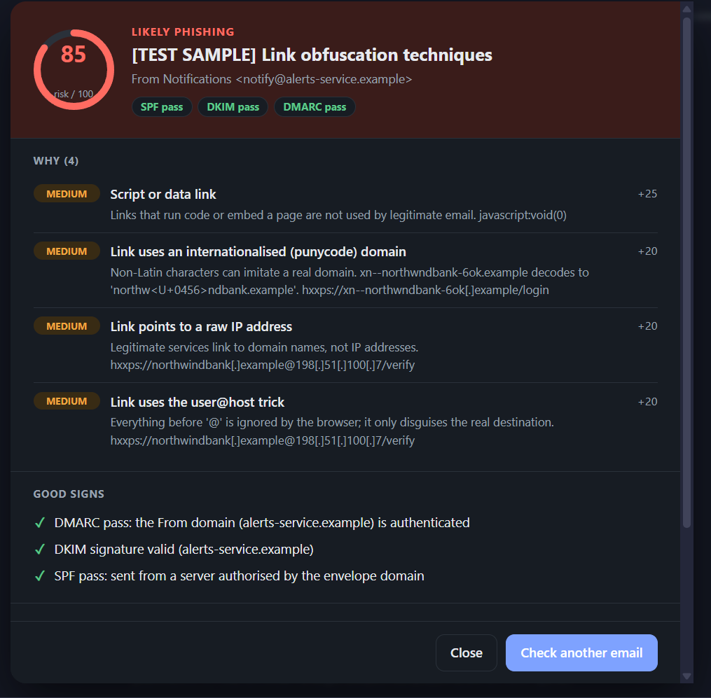

# phishcheck

An offline phishing email analyser. Give it an email downloaded from Gmail (`.eml`), or a whole Gmail folder exported with Google Takeout (`.mbox`), and it explains whether the email shows signs of phishing, and why.


```text
Subject : [TEST SAMPLE] Link obfuscation techniques
From    : Notifications <notify@alerts-service.example>
Verdict : LIKELY PHISHING   (risk score 100/100)
----------------------------------------------------------------------------------------------------
Findings
  HIGH    +35  Link imitates a known brand
               Northwind Bank: brand name 'northwindbank' appears in the subdomain, but the real
               domain is 'account-check.example'. hxxps://northwindbank[.]example[.]account-check[.]example/login
  MEDIUM  +25  Script or data link
  MEDIUM  +20  Link uses an internationalised (punycode) domain
               xn--northwndbank-6ok.example decodes to 'northw<U+0456>ndbank.example'.
  MEDIUM  +20  Link points to a raw IP address
  MEDIUM  +20  Link uses the user@host trick
Good signs
  + DMARC pass: the From domain (alerts-service.example) is authenticated
What to do
  Do not click links, open attachments or reply. In Gmail, open the three-dot menu and choose
  'Report phishing', then delete the email. ...
```

Note the "good signs" in that example: the sender passes SPF, DKIM and DMARC because attackers authenticate **their own** domains. Passing authentication proves who sent an email, not that they are trustworthy, which is why phishcheck looks at many kinds of evidence together.

## Safe by design

- **Nothing is executed or opened.** Links are only read as text, and attachments are only hashed and inspected byte-wise (a ZIP's file list is read, nothing is extracted).
- **Links are always shown defanged** (`hxxps://evil[.]com`) in every report, so you can't click them by accident.
- **Offline by default.** Nothing leaves your computer unless you pass `--online`. Even then, only domains, attachment hashes and the sending server's IP are sent, never full URLs (they often contain personal tokens such as password-reset or unsubscribe links) and never the email body.
- **No dependencies.** The Python standard library only.

## What it checks

| Area | Checks |
| --- | --- |
| **Authentication** | SPF, DKIM and DMARC results from Gmail's `Authentication-Results` header. Only the **top** header is trusted (it's written by Gmail); extra headers claiming to be from Gmail are flagged as forgeries. |
| **Sender** | Look-alike domains (typosquats like `paypa1.com`, homoglyphs like Cyrillic `а`, brand inside another domain), brand names in the display name only (`"PayPal" <x@random.com>`), a different address hidden in the display name, Reply-To redirection (incl. to webmail, the classic business email compromise pattern), and punycode domains. |
| **Links** | Link text that shows a different domain, raw IP addresses, `user@host` tricks, punycode/homoglyph domains, brand impersonation, URL shorteners, high-abuse TLDs, free hosting platforms, unencrypted login links, and `javascript:`/`data:` links. Results are aggregated per check, so 40 tracking links don't inflate the score. |
| **Attachments** | Dangerous types (`.exe`, `.js`, `.iso`, `.lnk`, `.one`...), double extensions (`invoice.pdf.exe`), right-to-left-override filename tricks, programs disguised by extension (detected by content: an `MZ` header in a `.pdf`), HTML attachments and whether they contain a password form, macro-enabled Office files, and archives containing risky files or protected by a password. |
| **Content** | Password forms in the body, urgency language, requests to log in or confirm details, payment/gift-card requests, generic greetings. Content scoring is **capped at 25**: wording alone can make an email "suspicious" but never "likely phishing". |
| **Online (optional)** | VirusTotal reputation for domains and attachment hashes, and AbuseIPDB reputation for the sending server's IP. |

### Scoring

Each finding adds points. The total (capped at 100) gives the verdict:

| Score | Verdict |
| --- | --- |
| 50 – 100 | **Likely phishing** |
| 20 – 49 | **Suspicious** |
| 0 – 19 | **No strong phishing indicators** (not a guarantee that an email is safe) |

Every report ends with plain-English advice on what to do next.

## Install

```bash
git clone https://github.com/alexsp10/phish-analyser.git
cd phish-analyser
python -m venv .venv
# Windows: .venv\Scripts\activate     Linux/macOS: source .venv/bin/activate
pip install -e ".[dev]"
```

## VS Code extension

PhishCheck also runs **inside VS Code**, with its own buttons:

- **🛡 PhishCheck** in the status bar (bottom left) opens the PhishCheck panel. Drop an email on it (hold **Shift** while dropping; VS Code needs that to drop into a panel) or click **Choose file**.
- With an `.eml` open, click the **shield button** at the top right of the editor, or right-click an `.eml` in the file explorer and choose **Check with PhishCheck**.

The panel is the same page as the browser window, but it talks to the extension instead of a web server: the extension runs `python -m phishcheck --json <file>` (with `execFile`, no shell) and shows the result. There's no server, no port and no network access, and the panel has a strict Content-Security-Policy.

Build and install it (no Node.js needed; the `.vsix` is packaged with Python):

```bash
python vscode-extension/build_vsix.py
code --install-extension dist/phishcheck-0.1.0.vsix
```

Then reload VS Code (`Ctrl+Shift+P` → **Developer: Reload Window**).

## Drag-and-drop window (browser)

The easiest way to use it: **double-click `PhishCheck.bat`** (or run `python -m phishcheck --gui`). A page opens in your browser:

> On Windows 11 with **Smart App Control** on, the generated `phishcheck.exe` launcher is blocked because it is unsigned. Use `python -m phishcheck ...` instead (the `.bat` file already does); every command in this README works that way.

1. In Gmail, open the email, click **⋮ → Download message**.
2. Drag the downloaded `.eml` file (from your Downloads folder or straight from the browser's download bar) onto the page.
3. The verdict pops up with a risk score, SPF/DKIM/DMARC status, the reasons ranked by severity, and what to do next.

<!-- Add a screenshot of the result pop-up as docs/gui.png, then remove these comment markers:  -->

The window is a tiny web server that runs only on your computer:

- it listens on `127.0.0.1` only, so nothing on your network can reach it;
- every upload must carry a random per-session token embedded in the page, so other websites open in your browser can't send files to it (CSRF);
- the `Host` header must be `127.0.0.1`/`localhost`, which blocks DNS-rebinding attacks;
- uploads are size-limited (25 MB) and analysed in memory;
- the page has a strict Content-Security-Policy (no external resources, nonce-locked script) and renders email text with `textContent` only, so a malicious subject line can't run code in the page.

Close the window's terminal (or press `Ctrl+C`) to stop it.

## Checking your Gmail from the command line

### One email
1. Open the email in Gmail on a computer.
2. Click the **three dots (⋮)** at the top right of the message, then **Download message**. Gmail saves an `.eml` file with all headers.
3. Run:
   ```bash
   phishcheck "C:\Users\you\Downloads\Your message.eml"
   ```

Forwarding a suspicious email to yourself instead of downloading it **destroys the evidence**: the authentication results and original headers get replaced with your own.

### A whole folder (for example, Spam)
1. Go to [takeout.google.com](https://takeout.google.com), click **Deselect all**, tick **Mail**, then **All Mail data included** and choose only the labels you want (e.g. *Spam*).
2. Export, download, and unzip. You get an `.mbox` file.
3. Run:
   ```bash
   phishcheck Spam.mbox --html report.html
   ```
   With more than 5 emails you get a ranked summary in the terminal, and `report.html` has the full details for each one.

### Options

```text
phishcheck PATH...            .eml / .mbox files, folders or glob patterns
  --gui                       open the drag-and-drop window (--port, --no-browser)
  --gui --vscode              show the window inside VS Code (Ctrl+Shift+P > Simple Browser: Show)
  --html FILE                 also write an HTML report
  --json                      machine-readable output
  --details                   full report for every email, even in big batches
  --brands FILE               add your own brands to protect (e.g. your bank)
  --online                    VirusTotal / AbuseIPDB lookups (needs API keys)
  --max-lookups N             VirusTotal lookups per email (default 4)
  --fail-on suspicious|phishing   exit code 2 for scripting
```

### Protect your own bank and services

The built-in list covers ~20 commonly impersonated brands (PayPal, Microsoft, Apple, Google, Amazon, DHL, banks and crypto exchanges...). Add the ones that matter to you:

```json
{
  "My Bank": {"keywords": ["mybank"], "domains": ["mybank.com", "mybank-online.com"]}
}
```

```bash
phishcheck message.eml --brands my-brands.json
```

### Optional online lookups

Create free accounts at [VirusTotal](https://www.virustotal.com) and/or [AbuseIPDB](https://www.abuseipdb.com), then set the keys for the current terminal session:

```powershell
$env:VT_API_KEY = "your-key"            # PowerShell
$env:ABUSEIPDB_API_KEY = "your-key"
phishcheck message.eml --online
```

Never commit your keys. `.env` files are git-ignored.

## Testing

`samples/` holds 15 labelled test emails (10 phishing techniques, 5 legitimate look-alikes) plus an `.mbox`, all produced by `scripts/generate_samples.py`. They are inert fixtures: they use a fictional brand (*Northwind Bank*), reserved `.example` domains and documentation-only IP ranges, every subject starts with `[TEST SAMPLE]`, and the "executables" are two-byte stubs that cannot run.

`samples/expected.json` records the verdict and findings each file must produce, and the test suite enforces it, together with unit tests for every check, the parser, look-alike detection (including false-positive cases like `applebees.com`), the scoring caps, HTML escaping, and the online lookups (against a fake API, so tests never use the network).

```bash
pytest
phishcheck samples --brands samples/demo-brands.json --html report.html
```

CI runs lint, a check that the samples match the generator, and the tests on Python 3.10 to 3.13.

## Limitations

- It is a triage aid, not a guarantee. A score of 0 doesn't mean an email is safe, especially for targeted messages from a compromised real account.
- Registrable domains use a small built-in list of country suffixes (e.g. `co.uk`) instead of the full Public Suffix List.
- Shortened links are flagged but not expanded (that would mean contacting the attacker's infrastructure).
- Only ZIP archives are inspected; RAR/7z contents can't be read without extra libraries.

## Licence

MIT. See [LICENSE](LICENSE).
